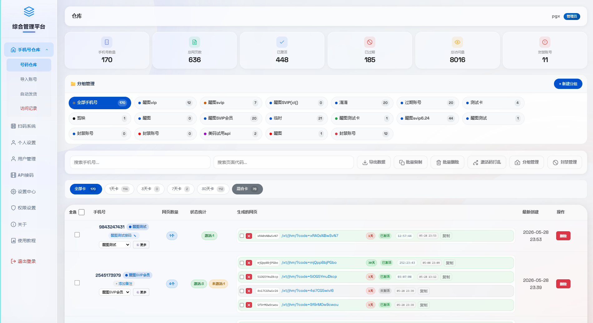
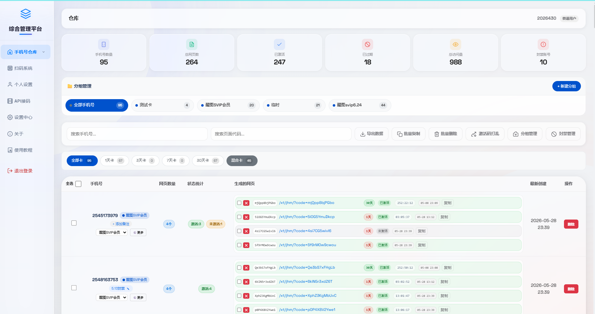
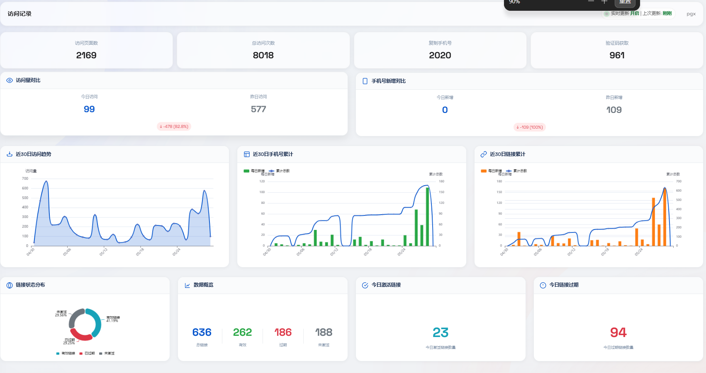
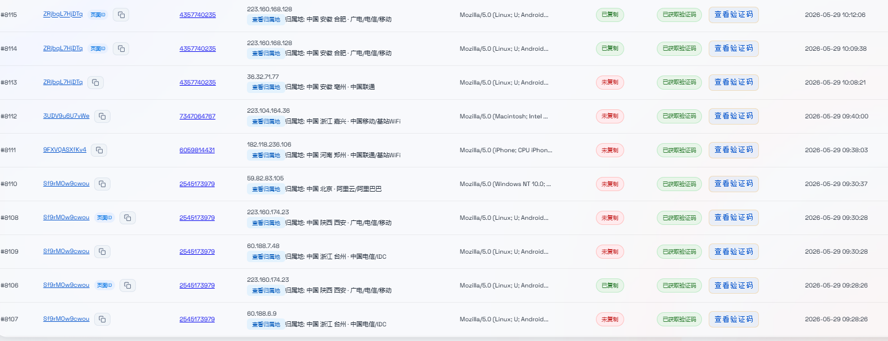
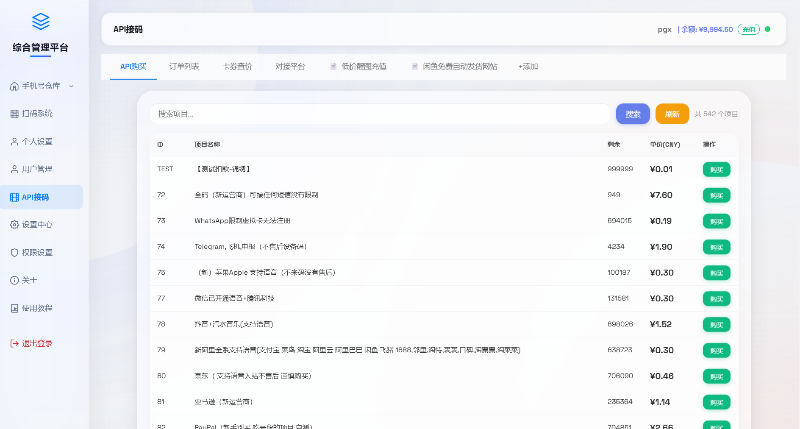
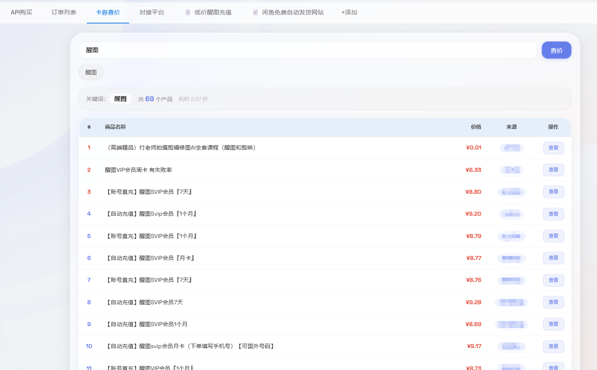
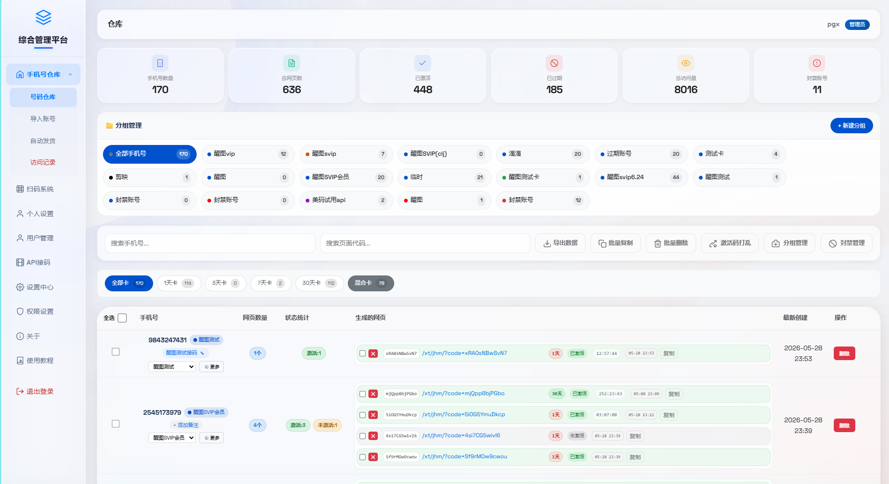
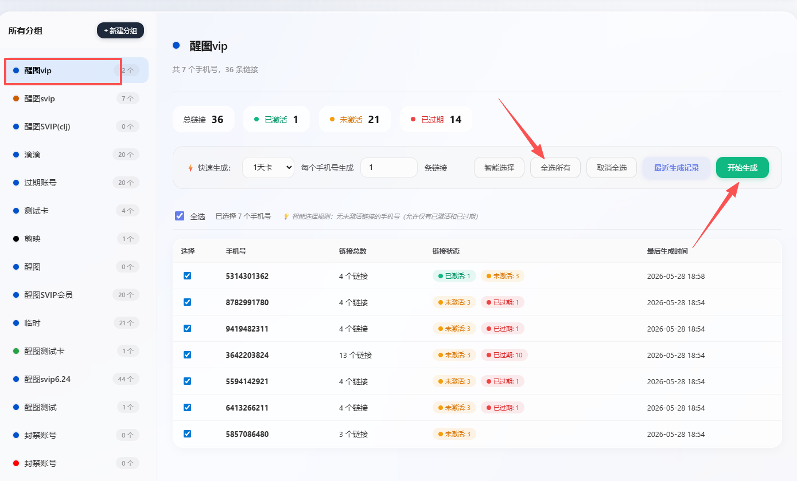
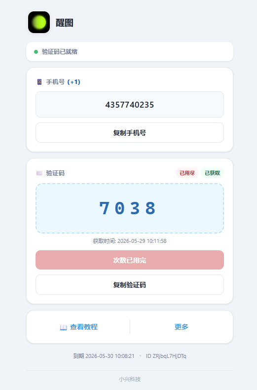

# 综合上号系统
#### 介绍
综合上号系统
1.包含api请求验证码(醒图，剪映，腾讯视频，哔哩哔哩)等，支持api接码号码导入
2.cookie扫码登录(百度网盘，夸克，腾讯视频，芒果TV，优酷视频)

#### 软件架构
 **主页展示(管理员页面)：** 

 **主页展示(普通用户页面)：** 

 **可视化统计** 

 **访问记录查询** 

 **API对接展示：** 

 _渠道价格充值展示_ 

#### 使用说明
1.api验证码请求导入格式：

2.生成链接使用：

3.在线验证码接收：

#### 参与贡献
