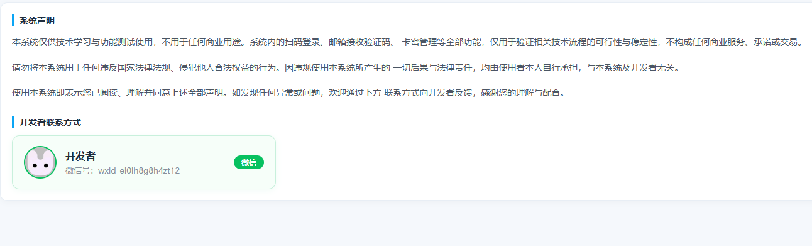
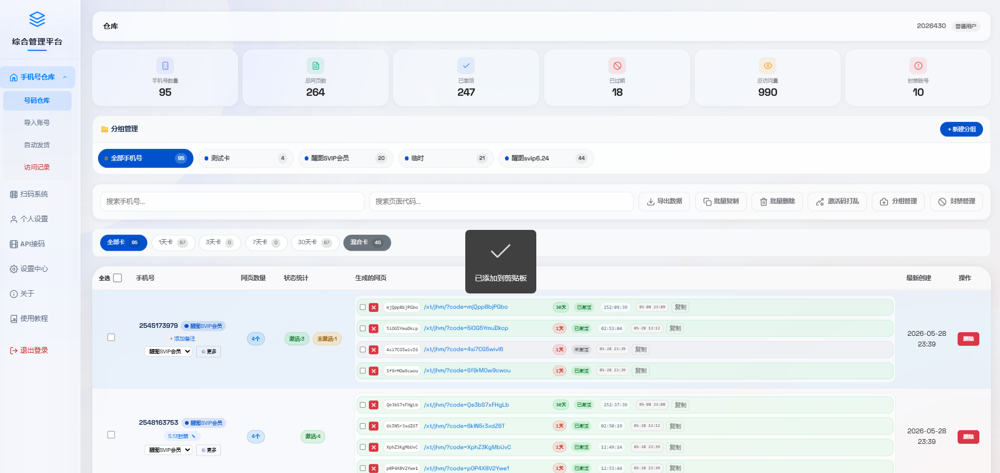
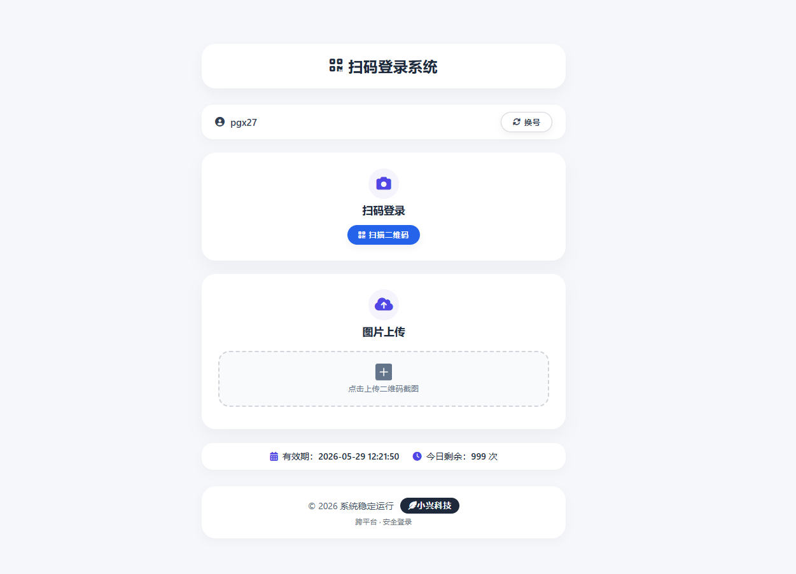
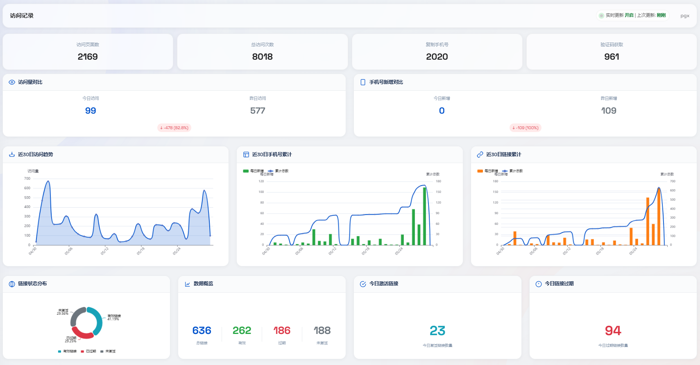
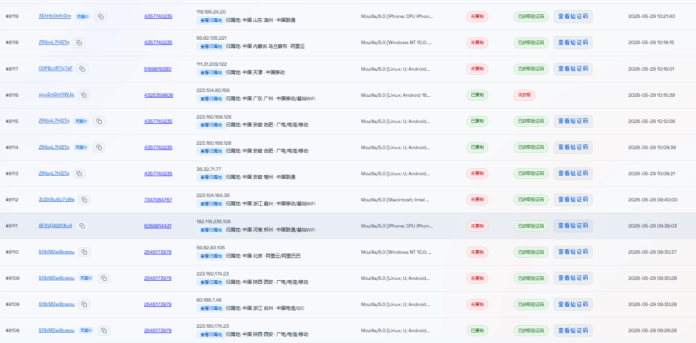
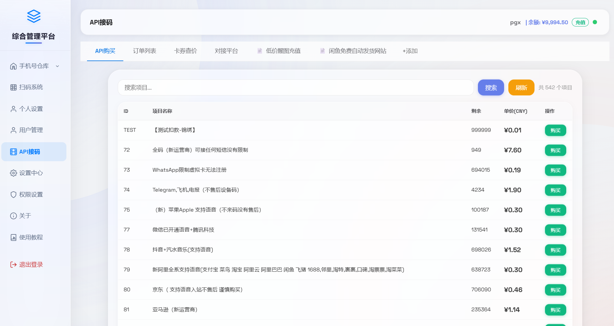
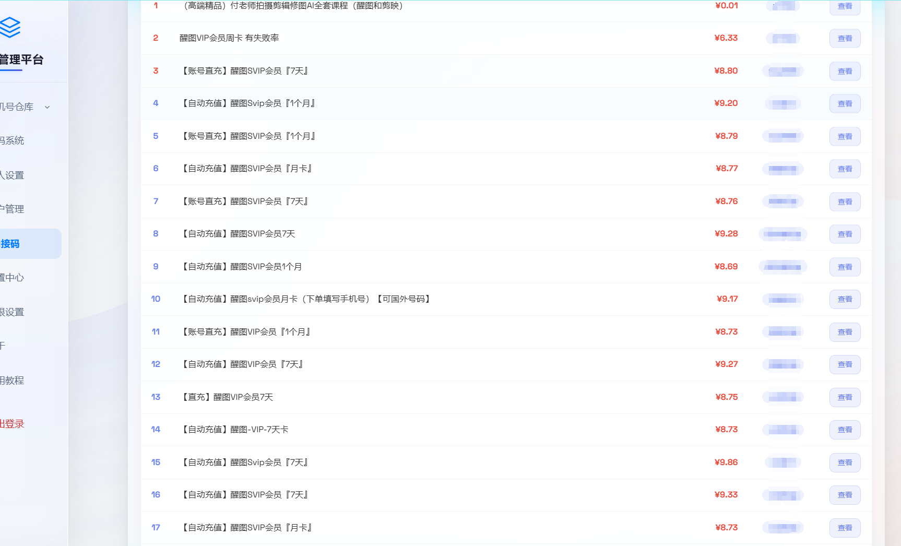
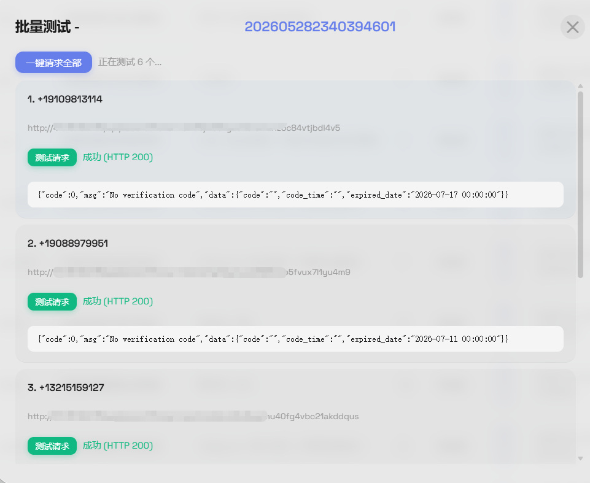
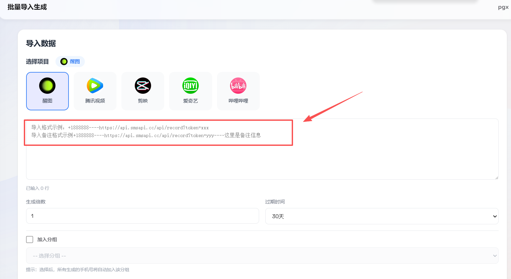
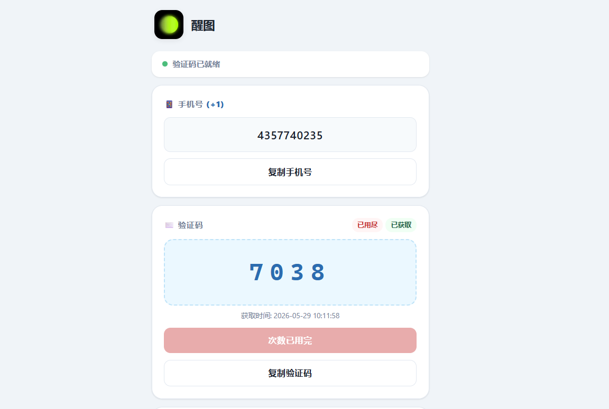

# 综合上号系统

一站式账号管理与自动化操作平台，集成主流平台的验证码接收、扫码登录、卡密批量生成与API对接等核心功能，为账号运营提供高效、安全的解决方案。
拼多多，闲鱼，淘宝等电商平台热门项目

### 作者联系：

## 功能特性

- **多平台验证码接收**：支持醒图、剪映、腾讯视频、哔哩哔哩等平台，API动态扩展，只需导入接码号码即可自动接收验证码。
- **Cookie扫码登录**：集成百度网盘扫码系统、夸克扫码系统、腾讯视频扫码系统、芒果TV扫码系统、优酷视频扫码系统等平台的扫码登录能力，支持批量卡密链接生成与状态管理。
- **在线验证码查询**：实时查看验证码接收记录与详情，支持时间、平台、号码等多维度筛选。
- **API对接与销售**：对外提供标准化API接口，支持下游渠道购买、会员价格查询、用量统计等功能。
- **用户与权限管理**：支持用户上下级分销体系，账号封禁/解封，验证码次数修改与增加，操作日志与访问记录设备追踪。
- **可视化统计面板**：展示系统整体调用趋势、收入概况、平台热度等关键指标。

## 界面展示

### 管理员首页

### 普通用户首页

### 扫码展示

### 可视化统计

### 访问记录查询

### API对接信息

### 渠道价格充值

### API一键请求

## 使用说明

### 1. API验证码请求导入
支持按平台、号码段、有效期批量导入接码号码，系统自动对接上游API，接收验证码并回传。

**导入格式示例：**

### 2. 在线验证码接收
用户可在控制台实时查看已接收的验证码内容，支持复制、标记已使用、导出记录等操作。

**界面示例：**

- **用户中心**：登录认证、上下级关系、余额与权限管理。
- **验证码引擎**：对接多平台验证码API，统一处理请求、轮询与回调。
- **卡密系统**：生成、加密、分发与核销各类卡密链接。
- **API网关**：对外提供签名认证的接口，支持渠道调用与计费。
- **监控日志**：记录访问设备、IP、行为路径，支持审计与异常告警。

